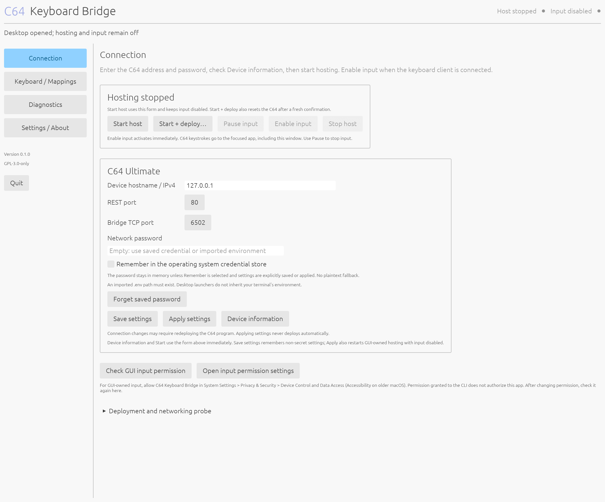

# C64 Keyboard Bridge

[](https://github.com/batuhanoktem/c64-keyboard-bridge/actions/workflows/ci.yml)
[](LICENSE)
[](https://github.com/batuhanoktem/c64-keyboard-bridge/commits/main/)

Use the physical Commodore 64 Ultimate keyboard as a keyboard for a modern computer. A real C64 PRG scans CIA1, sends physical key transitions through Ultimate UCI TCP sockets, and a Rust desktop companion or command-line host maps them to native input. No hardware modification or firmware replacement is required by the design.

This is GPL-3.0-only software, with dependency attribution in [third-party notices](THIRD_PARTY_NOTICES.md). The [desktop companion](docs/gui.md) includes a visual keyboard mapping editor, tray controls, retained diagnostics and optional OS credential storage. The CLI remains independently usable.

Physical testing of the CLI passed on C64 Ultimate firmware 1.1.0, FPGA 122, core 1.49 with ARM macOS and US layout: UCI binary networking, TextEdit/VS Code typing and shortcuts, held-key pause/resume, and local exit to BASIC. On 2026-10-12, after fixing per-key debounce and queued-release ordering, user-observed Windows US tests passed in Notepad, VS Code and a WSLg Linux scratch window, including repeat, pause/resume and recovery from a six-second C64 CPU traffic stall. The fixed client returned cleanly to BASIC.

Linux XTEST passed on isolated authenticated Xvfb servers on both architectures. On 2026-10-13, the native GNOME Wayland portal test delivered the exact phrase and Enter in Ubuntu Text Editor with standard US layout. GUI native input acceptance, physical C64-to-Linux/uinput, broader layouts, rollover, Wi-Fi outages and sustained scan/latency measurements still require the [hardware acceptance tests](docs/hardware-testing.md).

A limited VICE 3.10 check passed for the production scanner at idle, preserved interrupt state/CIA directions, and the client exit path with a mocked exit chord. It does not emulate UCI or prove physical key input.

## Build

Install Rust 1.99.0, a native C/linker toolchain, and [cc65](https://cc65.github.io/) with `cl65`, `cc65`, and `ca65` on `PATH`. `rust-toolchain.toml` pins Rust 1.99.0. macOS requires 10.15 or later on Intel and 11.0 or later on Apple Silicon; `brew install cc65` provides the C64 tools. Other platform details are in [platform support](docs/platforms.md).

```sh
make -C c64 all test
cargo build --release --locked
cargo test --workspace --locked
cargo install --path crates/bridge-cli --locked
```

The executables are `target/release/c64-keyboard-bridge-gui` and `target/release/c64-keyboard-bridge` (with `.exe` on Windows). Linux GUI builds need the development libraries listed in [build instructions](scripts/README.md). The standalone templates are `c64/build/KEYBRIDGE.PRG` and `c64/build/NETWORKTEST.PRG`; Cargo also builds and embeds the same verified templates in both frontends. Unconfigured templates display `NO CONFIG`. The host patches a copy in memory before deployment. See [C64 client details](c64/README.md).

For the pinned cc65 build, sanitizers, CLI smoke checks, and release archives, use [the build and package scripts](scripts/README.md). `scripts/check.sh` runs the complete local check path on macOS/Linux; pinned PRGs are emitted under `target/c64-prgs/` and archives under `target/dist/`.

## Desktop companion



The [screenshot gallery](docs/screenshots.md) includes macOS, Windows and Ubuntu GUI pages captured with isolated recording services, physical C64 Ultimate connected-client and successful-probe screens, and unconfigured C64 PRG startup screens in VICE. Each image records its origin; native input stays disabled during capture.

Install the architecture-specific macOS DMG, Windows per-user installer or Ubuntu 24.04+ DEB, or run `c64-keyboard-bridge-gui` from a portable archive. Hosting and input start disabled. This build uses a new private settings, pairing and credential namespace; re-enter configuration and the password when upgrading from earlier builds. Older data remains untouched without automatic migration. Enter your C64 address on Connection, choose a matching US/UK host layout, then start the host. Deploying either C64 program requires a separate confirmation because it resets the C64 and replaces its current program.

**Enable input** activates immediately after connection, permission and layout checks pass, even while the companion is focused. C64 keystrokes go to the focused application; changing focus does not pause input. Use **Pause input** in the window or tray to stop it. The deliberate native input test retains its confirmation and five-second countdown to switch to a scratch application. Closing the window keeps it in the tray when a tray is available; Quit releases keys and stops GUI-owned hosting. An existing separately started CLI session is identified and survives GUI Quit. Read [the GUI guide](docs/gui.md) for mappings, credential storage and installer signing status.

## Configure and test

```sh
cp .env.example .env
```

Edit the ignored `.env` file: set `C64_HOST` to your device's actual IPv4 address or hostname, and enter its network password privately. Do not put passwords in command arguments. Select the same US or UK input source on the computer as `KEYBOARD_LAYOUT`. Read [configuration](docs/configuration.md) for password quoting, interfaces, precedence, and defaults.

```sh
c64-keyboard-bridge doctor
c64-keyboard-bridge device info
c64-keyboard-bridge permissions
```

`doctor` and `permissions` inspect authorization without typing or opening a permission prompt. On macOS, explicitly request the Accessibility prompt with `c64-keyboard-bridge permissions --request`. A deliberate native test is `c64-keyboard-bridge test-input --countdown 5`: focus an empty scratch document before the countdown finishes and verify `c64 keyboard bridge` followed by Enter.

Before relying on UCI networking, stop the bridge and run:

```sh
c64-keyboard-bridge device test --allow-reset
```

This resets the C64 and replaces its running program with the network probe. Observe the C64 display, including peer closure and clean exit. REST success alone does not prove UCI sockets or physical keyboard operation.

## Run

`c64-keyboard-bridge start` runs in the foreground with native input disabled and no deployment by default. It reads device information when `AUTO_CONNECT=true`. To explicitly reset the C64, run the client, and enable native input in one command:

```sh
c64-keyboard-bridge start --deploy --allow-reset --enable-input
```

From another terminal using the same configuration and state directory:

```sh
c64-keyboard-bridge status
c64-keyboard-bridge pause
c64-keyboard-bridge resume
c64-keyboard-bridge stop
```

Pause, disconnect, and watchdog expiry release bridge-owned keys. Resume establishes a fresh baseline; ordinary keys already held must be released before they can type. Ctrl+C stops the host. Hold **Commodore + RUN/STOP for one second** to exit the C64 client gracefully. Abrupt C64 resets rely on the host watchdog.

`device deploy --allow-reset` loads the patched keyboard client without running it. `device run --allow-reset` loads and starts it. Both reset the C64 and interrupt its software. Do not retry an ambiguous upload failure until you inspect the device.

## Test without hardware

Start a loopback recording host in one terminal:

```sh
c64-keyboard-bridge start --fake-device --enable-input
```

In another terminal, run:

```sh
c64-keyboard-bridge --device-host 127.0.0.1 --advertise-ip 127.0.0.1 --backend recording simulate --scenario typing --fragment
c64-keyboard-bridge status
c64-keyboard-bridge stop
```

The fake host forces loopback, the recording backend, and no device contact or deployment. Other simulator scenarios are `disconnect-held`, `heartbeat-timeout`, and `malformed`. They exercise transport behavior without native input.

Read [mappings](docs/mappings.md), [protocol](docs/protocol.md), [architecture and firmware evidence](docs/architecture.md), [security](docs/security.md), [troubleshooting](docs/troubleshooting.md), and [hardware acceptance tests](docs/hardware-testing.md) for the practical limits and validation procedure.

See [device compatibility](docs/device-compatibility.md), [builds and release verification](docs/build-and-release.md), [contributing](CONTRIBUTING.md) and [the changelog](CHANGELOG.md).
