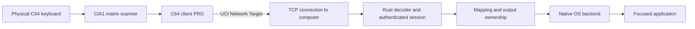

# Architecture and firmware evidence

`bridge-protocol` owns bounded framing, sequences, physical key IDs, and matrix state. `bridge-core` owns layout mappings, output ownership, Shift compatibility, repeat, and the recording backend. `bridge-host` owns configuration, REST deployment, pairing, sessions, local control, diagnostics, and native backends. `bridge-cli` provides commands and embeds both PRGs.

The C64 foreground loop requests a scan whenever it observes a changed KERNAL jiffy. Each physical key must agree across two observations before its transition is accepted; changes on other keys do not restart its debounce. A tap shorter than two observed samples can still be missed. A physical read-only measurement in BASIC observed a nominal 60 Hz counter rate; actual client scan cadence under sustained traffic remains unmeasured. UCI work yields after at most 32 copied bytes; network batches are at most 128 bytes. Sampling continues while firmware handles a command. A 128-event C64 queue and a bounded host event queue fail closed on overflow. The host's dedicated input thread applies native calls sequentially and uses generations to invalidate events across pause, synchronization, and session reset. Mid-session snapshots must agree with ordered transitions; disagreement ends the session and reconnect establishes a fresh baseline. Neither side assumes TCP write boundaries are frame boundaries.

## UCI transport

The client uses the documented `$DF1C` control/status, `$DF1D` command/ID, `$DF1E` response, and `$DF1F` status registers. It builds only in idle, sets `PUSH_CMD`, waits for Data Last or Data More, drains response and status queues separately, and sets `DATA_ACC`. More blocks return through busy; the last returns to idle. ABORT requests eventual recovery and does not guarantee immediate preemption. The implementation uses no UCI DMA, trigger, or completion IRQ mode. [Official UCI architecture](https://1541u-documentation.readthedocs.io/en/master/uci/core_uci_architecture.html).

Network target `03` supplies Identify `01`, TCP Open `07`, Close `09`, Read `10`, and Write `11`. Open receives a little-endian port and NUL-terminated destination; subsequent payloads use explicit lengths. Read/write response counts are interpreted as signed little-endian values. Partial writes preserve the unsent tail before any later frame. [Official Network Target commands](https://1541u-documentation.readthedocs.io/en/master/uci/network_target.html).

Historical source supplies important details missing from the command summary: idle read is `-1` with `02,NO DATA: 11`; other errno values are failures. Confirmed zero-count `01,CONNECTION CLOSED BY HOST` means firmware already closed the socket, so the handle is invalidated without a second CLOSE. Other owned handles are explicitly closed. Timeout or failed close can leave ownership uncertain on older firmware; the client halts retries instead of assuming it is safe to open again. [Historical v3.14 network implementation](https://github.com/GideonZ/1541ultimate/blob/v3.14/software/io/network/network_target.cc).

## REST and compatibility

Deployment sends the entire patched PRG, including its two-byte load address, as an `application/octet-stream` POST to `/v1/runners:load_prg` or `/v1/runners:run_prg`. `X-Password` authenticates the request. Both operations reset the C64; load does not run, while run does. The host also checks the JSON `errors` array, including successful HTTP responses. [Official REST API](https://1541u-documentation.readthedocs.io/en/latest/api/api_calls.html).

Authenticated `GET /v1/info` and the physical network probe succeeded on 2026-10-11 on the target device, reporting firmware 1.1.0, FPGA 122, and core 1.49. The probe verified TCP, binary transfer, ACK and idle reads; peer closure was observed on the C64 screen, and the user confirmed its local exit returned to BASIC. The keyboard client passed the initial 22-transition sequence, clean host restart/reconnect, user-observed TextEdit and VS Code checks, held-key pause/resume and local exit to BASIC on ARM macOS with US layout. Its observed exit displayed `00,OK`; the complete session had 391 raw events, no errors and no blocked combinations. Other layouts/platforms, rollover and broad error/interruption recovery remain unverified. Installed firmware is not assumed equivalent to generic Ultimate v3.14 or current master. Later source and documentation include networking and IRQ changes, so a repository version label or `$C9` ID cannot establish installed behavior. The probe's evidence is associated with device ID, firmware, FPGA, and core versions; changing them requires new acceptance evidence. See [hardware observations](hardware-testing.md) for measured transaction jiffies and the remaining checks.

On 2026-10-12, the fixed client and Windows host also passed the user-observed US Notepad retest, VS Code, held-key pause/resume, recovery from a six-second C64 CPU traffic stall and delivery through Windows input to a WSLg GTK scratch window. The fixed client returned to BASIC on local exit. Native physical Linux/uinput, broader layouts/rollover and Wi-Fi radio/access-point outages remain unverified. See the [Windows/WSLg record](hardware-testing.md#windows-and-wslg-observations), including the initial typing failure and separately reproduced software fixes.

[c64weather](https://github.com/mbosschaart/c64weather) was a primary reference for feasibility. Its source was not copied. This project checks counts, bounded responses, partial writes, and status ownership independently. See the [C64 implementation notes](../c64/README.md) and [hardware acceptance procedure](hardware-testing.md) for remaining uncertainty.
