# Screenshot gallery

Desktop images show the actual application renderer with isolated recording services. Hosting and input are off, passwords are empty and the visible loopback addresses belong to the fixture. These images demonstrate the interface, not physical keyboard acceptance. The [image manifest](screenshots/manifest.json) records origin, capture revision, dimensions and SHA-256 hashes.

## macOS

Connection controls and the Mac permission-settings link:


Physical keyboard and shared mapping preview:

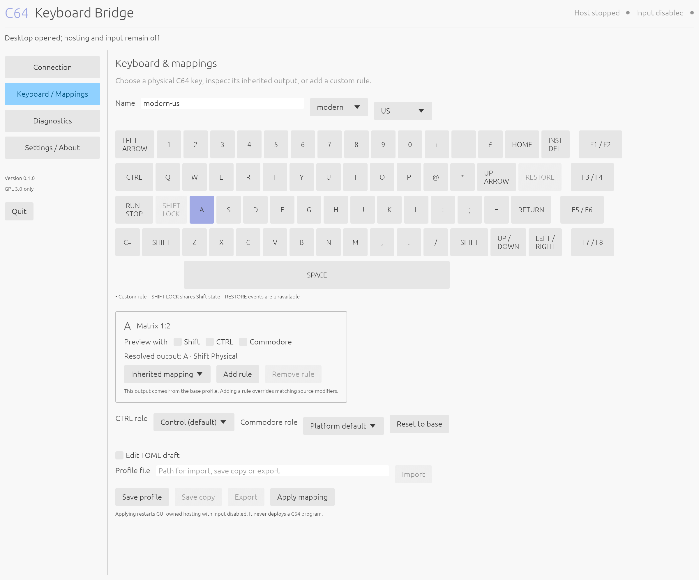

Diagnostics for the GUI posting process:

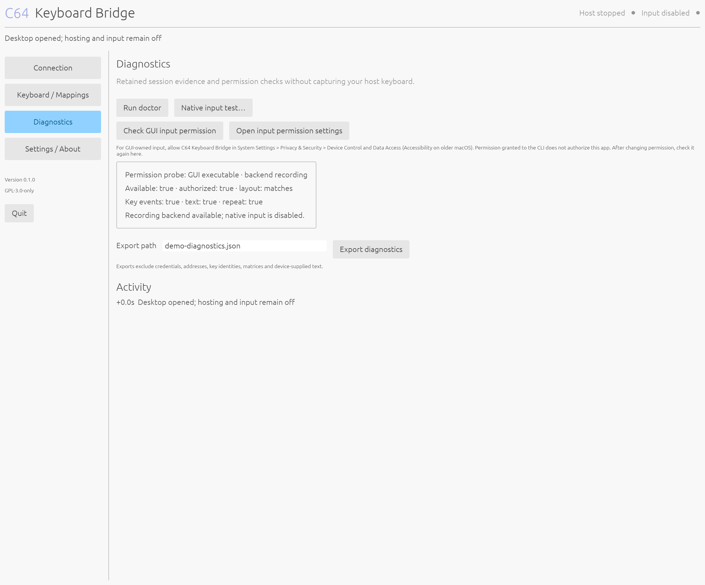

Settings show Mac backends and Keychain instructions:

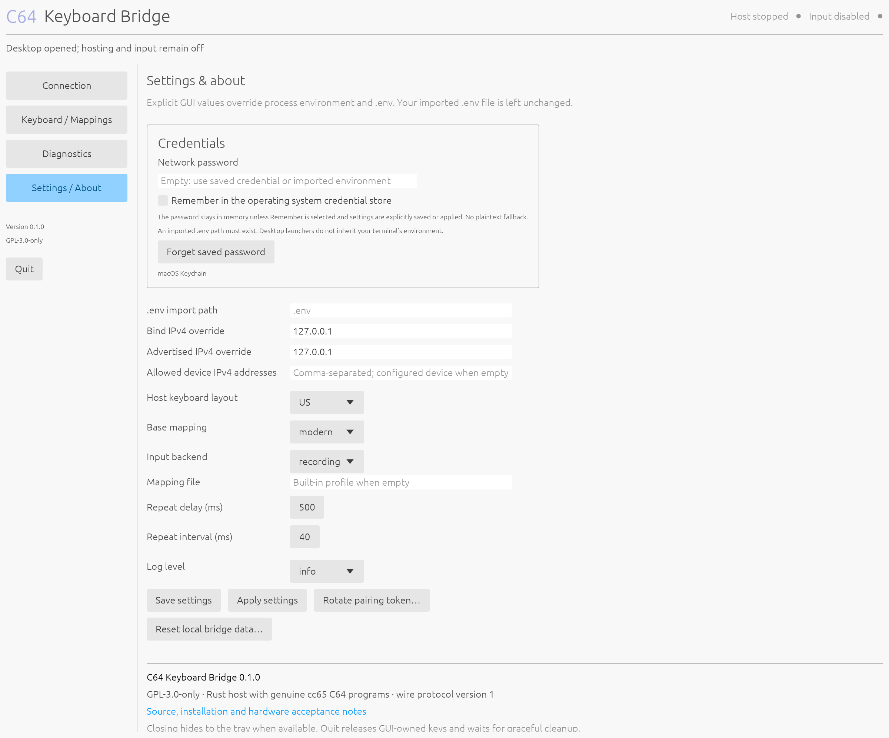

Password-store waiting state: Start host and Device information remain available while Remember and Forget are disabled. This is the actual macOS renderer with a simulated delay; the fixture makes no Keychain request.

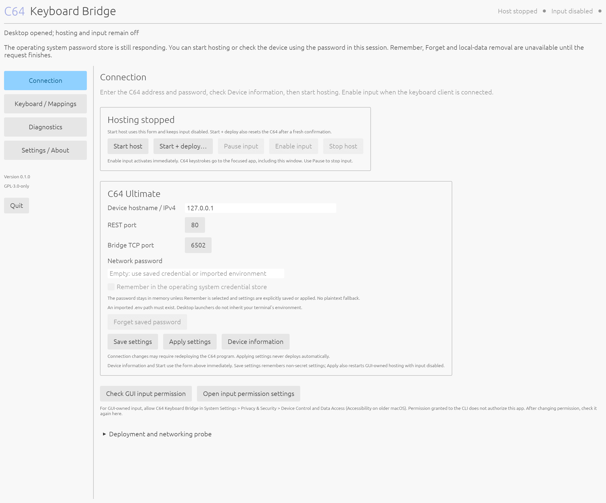

Dark theme, selected only for this capture without changing the system theme:

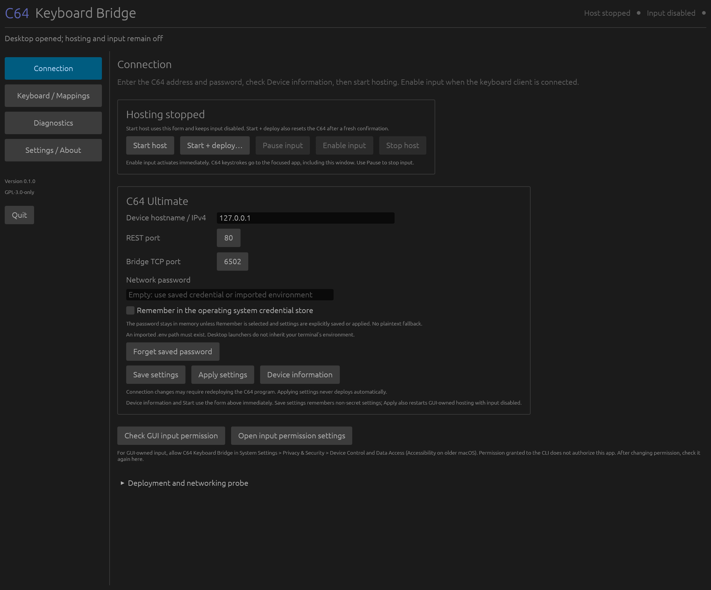

## Ubuntu

Actual GUI captures on Ubuntu in a native Wayland session, using isolated recording services. Linux controls show GNOME portal guidance, the current backend choices and desktop-controlled repeat.

Connection controls and GNOME Wayland permission guidance:

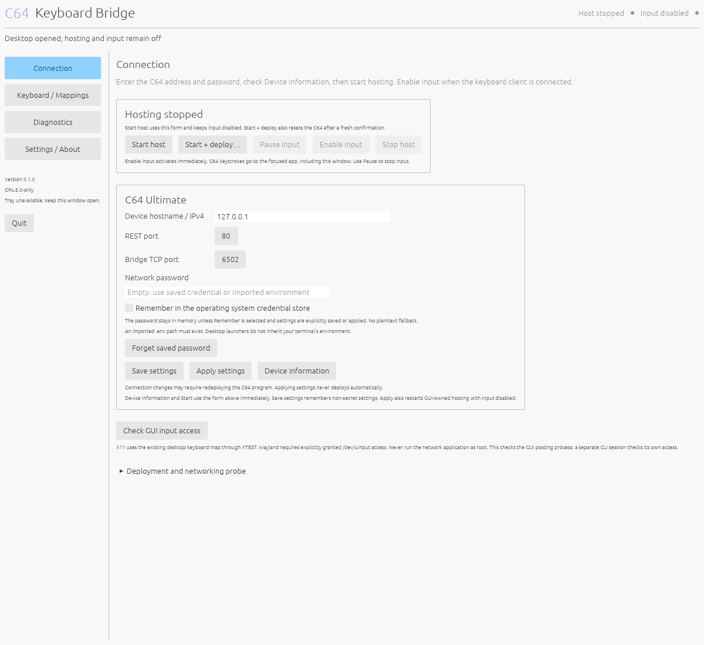

Physical keyboard and shared mapping preview:

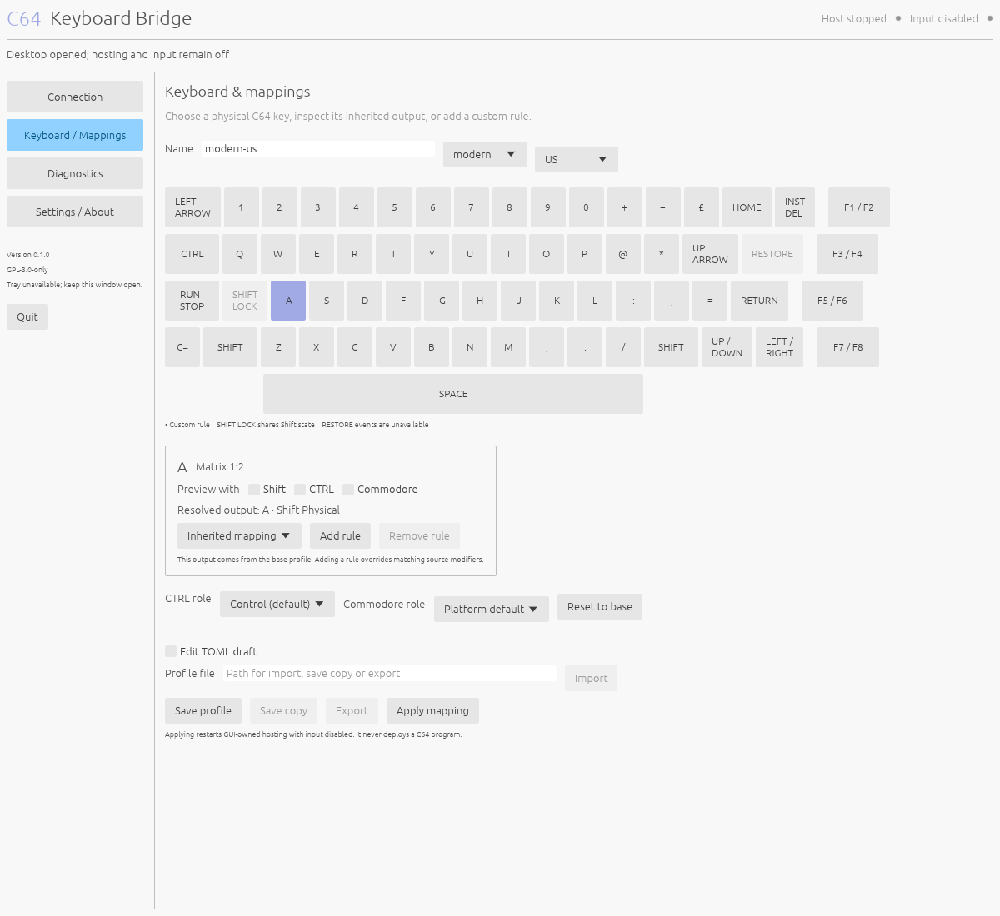

Diagnostics for the GUI posting process using recording-backend evidence:

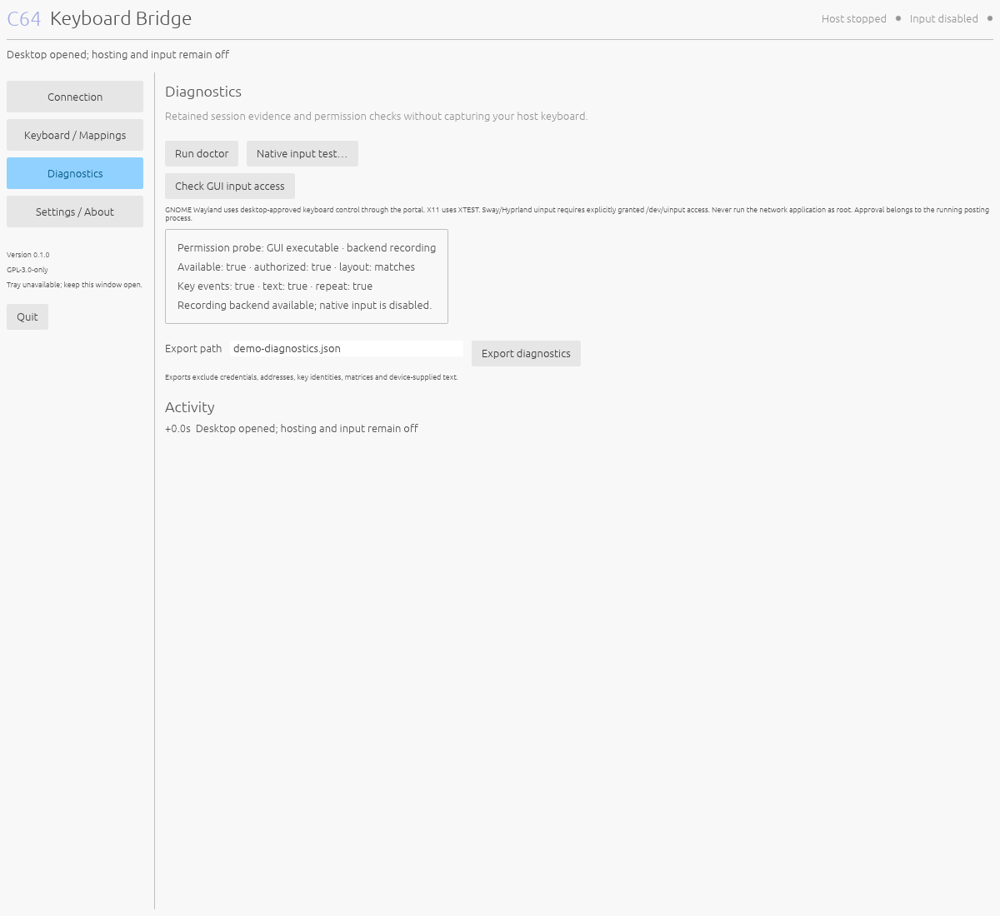

Settings show Linux Secret Service guidance and desktop-controlled repeat:

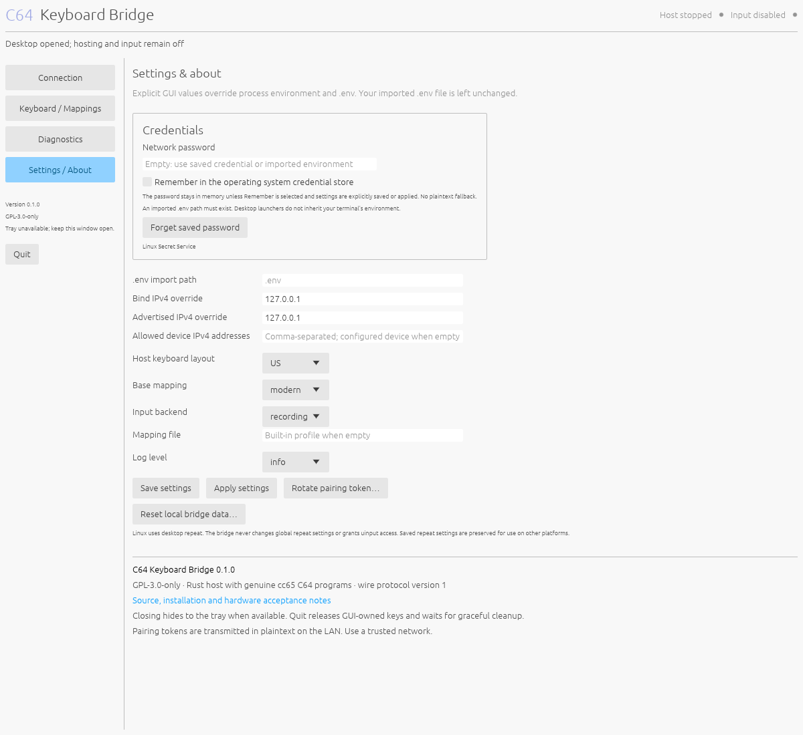

Password-store waiting state on Ubuntu: connection controls remain available while Remember and Forget are disabled. This is the actual native Wayland GUI with a simulated delay; the fixture makes no Secret Service request.

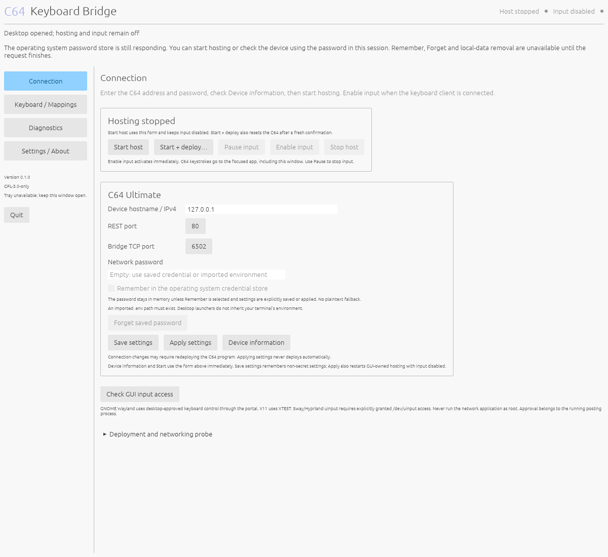

Dark theme, selected only for this capture without changing the system theme:

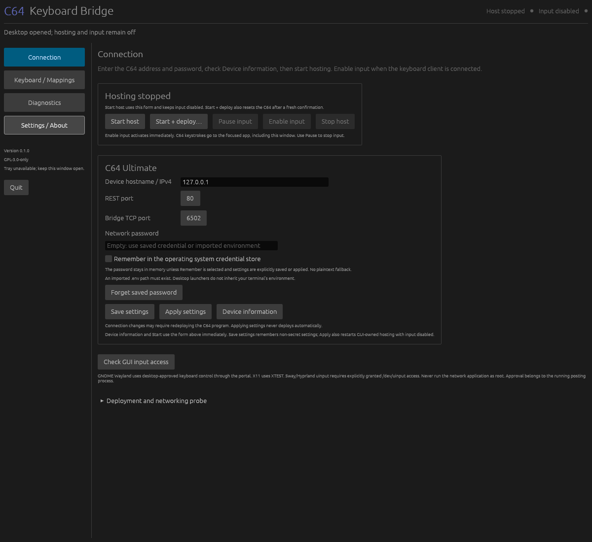

## C64 programs in VICE

These are the genuine, unconfigured release templates running in VICE 3.10. They display deployment instructions because no pairing token or network destination is embedded. VICE does not emulate Ultimate UCI, so these images do not show or claim successful networking. The original 384 × 272 pixel proportions are preserved.

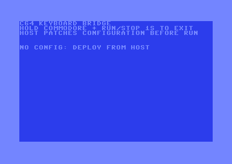

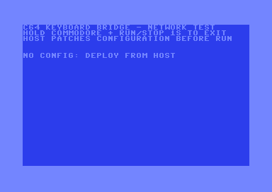

Real connected-client and successful-probe captures remain pending a separately approved hardware session. Capturing an existing video stream may be possible on suitable firmware; loading either PRG still requires fresh reset consent.

## Reproduce isolated captures

```sh
python3 scripts/gui-smoke.py --binary target/debug/c64-keyboard-bridge-gui --theme light --output target/captures/light
python3 scripts/gui-smoke.py --binary target/debug/c64-keyboard-bridge-gui --theme dark --output target/captures/dark
python3 scripts/gui-smoke.py --binary target/debug/c64-keyboard-bridge-gui --theme light --credential-pending --output target/captures/password-store
python3 scripts/c64-screenshots.py --output target/captures/c64
```

The GUI helper uses memory credentials and recording services. Linux runs in a private authenticated Xvfb display and D-Bus session. VICE requires separately installed, legally obtained C64 ROMs; no ROMs are distributed in this project.

The password-store command sets only the rendered pending status and records `simulated_credential_pending: true` in `gui-result.json`. It does not start a real credential operation. Its `gui-connection.png` shows the waiting state illustrated above. The other gallery images were captured without this option.
